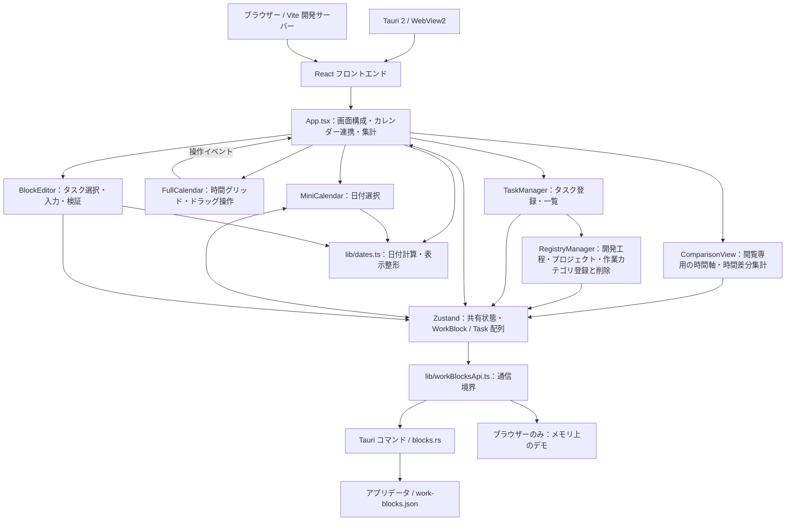

# DevScope アーキテクチャ

## 1. 目的と実装範囲

DevScope は、PSP（Personal Software Process）の考え方に基づき、ソフトウェア開発の予定と実績を記録・比較する Windows 向けアプリケーションです。カレンダーの画面操作・ローカル保存に加え、予定と実績の並列表示と日／週単位の時間差分集計を実装しています。個別ブロックの自動対応付けは未実装です。

ブラウザー版と Tauri 版は同じ React フロントエンドを使用します。Tauri の Rust コードはウィンドウ起動と作業ブロックおよびタスクの API・入力検証・JSON 永続化を担当します。ブラウザー版はメモリ上のデモです。SQLite、Git 連携、AI 分析、予定と実績の自動対応付けは未実装です。
コマンドの契約は [API ドキュメント](docs/api/work-blocks.md)、判断理由は [ADR 0001](docs/adr/0001-work-block-persistence.md) を参照してください。

## 2. 全体構成

React コンポーネントの親子関係と状態の流れは [フロントエンド設計](docs/architecture/frontend.md) を参照してください。

Zustand が確定済みの作業データと共有する表示状態を保持します。FullCalendar にはストアから変換したイベントを渡し、編集操作をストアに戻します。FullCalendar の内部データを独立した保存先として扱いません。

## 3. 技術と責務

| 技術 | 現在の役割 |
| --- | --- |
| Tauri 2 / Rust 1.89以降 | Windows ウィンドウの生成、フロントエンドの表示、作業ブロック API・JSON 永続化 |
| React 18 / TypeScript 5 | コンポーネント構成、入力処理、型定義。TypeScript は strict モード |
| Vite 6 | 開発サーバーと本番アセットの生成 |
| Tailwind CSS 3 / PostCSS | ユーティリティクラスの生成 |
| shadcn/ui 方式の UI 部品 / Radix UI | ボタン、ダイアログ、予定・実績／日・週の選択部品 |
| FullCalendar 6 | 日・週の時間グリッド、範囲選択、移動、リサイズ |
| Zustand 5 | 選択日・表示モード・フィルター・作業ブロックの共有 |
| lucide-react | 画面内のアイコン |
| Playwright | ブラウザー操作と日付計算のテスト |
| Husky / commitlint | コミットメッセージの形式検証 |

正確な依存バージョンは [package-lock.json](package-lock.json)、Rust 側は [Cargo.lock](src-tauri/Cargo.lock) で固定しています。

## 4. ディレクトリと主要ファイル

| パス | 責務 |
| --- | --- |
| [src/main.tsx](src/main.tsx) | React の起動。StrictMode 内で App を描画 |
| [src/App.tsx](src/App.tsx) | ヘッダー・サイドバー・集計の構成、FullCalendar との接続、編集対象の管理 |
| [src/components/MiniCalendar.tsx](src/components/MiniCalendar.tsx) | 6週・42日分の月間表示、月移動、選択日・選択週・今日の強調 |
| [src/components/BlockEditor.tsx](src/components/BlockEditor.tsx) | 作業ブロックの作成・編集・削除と入力検証 |
| [src/components/ComparisonView.tsx](src/components/ComparisonView.tsx) | 各日の予定・実績を共通の時間軸へ配置し、合計・内訳を表示 |
| [src/lib/comparison.ts](src/lib/comparison.ts) | タスク・プロジェクト・工程別の差分集計と重複ブロックの配置 |
| [src/components/TaskManager.tsx](src/components/TaskManager.tsx) | 日時を持たないタスクの事前登録・一覧と入力検証 |
| [src/components/RegistryManager.tsx](src/components/RegistryManager.tsx) | 開発工程・プロジェクト・作業カテゴリの登録・一覧・削除と入力検証 |
| [src/data/defaultCategories.ts](src/data/defaultCategories.ts) | 初回起動・旧データ用のカテゴリ名称と配色。実行中の正本はストア |
| `src/components/ui/` | Radix UI 等を使う共通部品。業務データへの依存は持たない |
| [src/store/calendar.ts](src/store/calendar.ts) | 作業データの型、カテゴリ定義、Zustand ストア |
| [src/data/demoBlocks.ts](src/data/demoBlocks.ts) | 初回表示用サンプルの定義（`demoBlockTemplates`）と生成処理（`createDemoBlocks`） |
| [src/lib/dates.ts](src/lib/dates.ts) | ローカル日付の変換、週・月の計算、期間と所要時間の表示 |
| [src/lib/workBlocksApi.ts](src/lib/workBlocksApi.ts) | Tauri コマンドへの接続、ブラウザー用デモアダプター |
| [src-tauri/src/blocks.rs](src-tauri/src/blocks.rs) | 作業ブロックの検証・取得・作成・更新・削除・ファイル保存 |
| [src/lib/utils.ts](src/lib/utils.ts) | clsx と tailwind-merge を使ったクラス名の統合 |
| [src/styles.css](src/styles.css) | 配色、レイアウト、画面幅への対応、FullCalendar の表示調整 |
| [components.json](components.json) | shadcn/ui の部品追加に使う設定とエイリアス |
| [src-tauri/src/main.rs](src-tauri/src/main.rs) | Tauri アプリケーションの起動 |
| [src-tauri/tauri.conf.json](src-tauri/tauri.conf.json) | ウィンドウ、開発 URL、配布アセット、CSP、アイコンの設定 |
| [public/devscope.svg](public/devscope.svg) | AI が SVG コードを生成して作成したアプリアイコン。生成元を SVG 内にも記載 |
| `src-tauri/icons/` | SVG から変換した Windows・Tauri 用の PNG / ICO |
| `tests/` | 日付計算とカレンダー操作のテスト |

`@/` は `src/` を指します。TypeScript と Vite の両方に同じエイリアスを設定しています。

## 5. データモデルと状態の所有者

### 作業ブロック

`WorkBlock` は予定または実績の1件を表します。

| フィールド | 内容 |
| --- | --- |
| `id` | 識別子。デスクトップはバックエンドで採番、ブラウザーのデモは `crypto.randomUUID()` |
| `title` | 作業名 |
| `start`, `end` | ローカル日時文字列 `YYYY-MM-DDTHH:mm` |
| `mode` | `plan`（予定）または `actual`（実績） |
| `category` | 登録されたカテゴリの ID。初期4件の ID は維持し、追加分は `category-N` |
| `project` | 任意のプロジェクト名。プロジェクトマスターへの参照ではない |
| `phase` | 任意の開発工程名。旧データ・省略入力は空文字。タスク選択時のコピー |
| `note` | 任意のメモ |

予定と実績は同じ配列内に保持し、`mode` で表示を絞り込みます。予定の編集を実績へ反映する処理や、予定から実績へ変換する処理はありません。
表示状態は `CalendarMode = Mode | 'compare'` を使い、保存する `WorkBlock.mode` は従来の `plan | actual` を維持します。比較時は両モードを共通の期間・カテゴリで絞り込み、各日の隣接列に並べます。集計は派生値として描画時に計算し、日またぎ・週またぎを表示期間で切り詰めます。詳細は [ADR 0006](docs/adr/0006-calendar-comparison.md)。

### タスク

`Task` は `id`、`title`、`category`、`project` を持つ日時未定の作業です。登録画面で作成し、予定・実績の選択時に内容をブロックへコピーします。ブロックはタスクへの外部参照を持たず、タスク削除後も履歴を保持します。カテゴリ・プロジェクトは選択後に調整できます。タスクの名前編集は未実装です。[ADR 0002](docs/adr/0002-task-registration.md) に保存互換性と判断を記録しています。

タスクには任意の `phase`（開発工程名）も保持します。開発工程はカテゴリとは独立して登録し、タスクからブロックへコピーします。開発工程・プロジェクトの候補は一意な名前の配列で、登録・取得・削除 API を持ち、既存 JSON に保存します。旧データでは候補配列を空として読み込み、履歴の名称を候補末尾に補います。名前の編集は未実装です。判断と検証条件は [ADR 0003](docs/adr/0003-task-registries.md) と [ADR 0004](docs/adr/0004-category-registration-and-deletion.md) を参照してください。

カテゴリは `{ id, label, color, background }` の登録データで、Zustand の `categories` が名称・配色の正本です。初期4件を含め、未使用なら削除できます。タスクまたはブロックで使用中のカテゴリ・工程・プロジェクトは `IN_USE` として削除を拒否します。保存後にだけ一覧を変更します。カテゴリ0件の状態も保存し、タスク登録では新規カテゴリの登録を促します。追加カテゴリは既存の緑色を使用し、色編集は未実装です。既存の開発時間の集計対象は引き続き `development` です。

### デバッグ用サンプルの追加

カレンダー下部のボタンは `createDemoBlocks(now, weekDate)` で表示週のサンプルを生成し、ストア経由で `import_sample_data` を呼びます。Rust は全入力を検証し、タスク・不足カテゴリ・ブロックを1回の JSON 保存で追加します。確定済み一覧と追加件数を返し、ストアへまとめて反映します。同じ内容は追加せず、既存データを上書きしません。日付は端末ローカル、実績は操作時点で終了済みのものだけです。初回の自動投入は行いません。[ADR 0005](docs/adr/0005-sample-data-import.md) に失敗時・重複・補完規則を記録しています。

### 共有状態とローカル状態

| 所有者 | 状態 |
| --- | --- |
| Zustand | `date`（選択日）、`view`（日／週）、`mode`（予定／実績）、`sidebarOpen`、`visibleCategories`、`blocks`、`tasks` |
| Zustand | 候補一覧の `phases` / `projects`、非同期状態の `loadState`、`loadError`、`saving`。保存成功値だけを反映 |
| App | `screen`（カレンダー／タスク登録）、`draft`（編集対象のコピー）、`announcement`（操作の読み上げ通知）、FullCalendar の参照 |
| MiniCalendar | `month`（ミニカレンダーで閲覧中の月） |
| BlockEditor / TaskManager | 保存前の入力内容と検証エラー |
| TaskManager / RegistryManager | 登録画面の選択、登録前の名前・検証エラー・保存通知。画面往復中も TaskManager のタスク入力を保持 |

初期状態は今日・週表示・予定・サイドバー表示・全カテゴリ表示です。デスクトップは保存済み作業を全件読み込み、初回は空の一覧です。ブラウザーでは起動時に、その週のサンプル予定と、終了時刻が起動時刻以前のサンプル実績を生成します。サンプルは時間経過に応じて自動追加されません。

サンプルの変更箇所は `src/data/demoBlocks.ts` の `demoBlockTemplates` です。各データは項目名付きのオブジェクトで記述し、曜日は月曜0〜日曜6、開始・終了時刻は `HH:mm` で指定します。通信アダプターが `createDemoBlocks()` を呼び出します。サンプル側はストアの型を `import type` で参照し、実行時にはストアを読み込みません。

ストアに永続化ミドルウェアはありません。デスクトップの作業データは Rust API 経由でアプリデータ内の JSON に保存します。表示状態と保存前の入力は永続化しません。ブラウザー版は再読み込みで変更が失われます。

## 6. 主要なデータフロー

### 日付と表示の同期

1. 今日・前後の期間・ミニカレンダーの操作が `setDate` を呼ぶ。
2. 日／週の切り替えが `setView` を呼ぶ。
3. App の effect が FullCalendar の `changeView` に表示形式と選択日を渡す。
4. MiniCalendar は共有の選択日が変わると、その日を含む月へ移動する。

ミニカレンダーだけの前月・翌月移動では、閲覧中の月のみ変更します。日付をクリックした時点でメインカレンダーへ反映します。メインカレンダーの日付見出しをクリックすると、その日の日表示に切り替わります。

### 作成・編集・削除

1. 追加ボタン、空き時間のクリック、範囲ドラッグで新規 `draft` を作る。追加ボタンの初期時刻は選択日の9時から1時間。
2. 既存ブロックのクリックでは、ID に対応するストア内の値を `draft` にコピーする。
3. BlockEditor は登録済みタスクを選択し、内容をフォームへコピーする。保存時は選択と日時を検証する。旧ブロックでは「現在の作業」を維持して編集できる。
4. ID の有無に応じて非同期の `addBlock` / `updateBlock` を呼ぶ。削除は `deleteBlock` を呼ぶ。
5. API の保存成功値をストアに反映してからダイアログを閉じ、FullCalendar のイベント一覧と集計を再計算する。失敗時は入力とエラーを保持する。

キャンセルやダイアログを閉じる操作では、入力途中の値をストアへ反映しません。タスク登録では作業名の空白だけの入力を禁止し、ブロックではタスク選択と有効な正の所要時間を確認します。文字数制限は入力要素で設定しています。

BlockEditor の検証に加え、バックエンドでも日時形式・実在する暦日・開始終了の順序・文字数・列挙値を検証します。部分更新は既存値と統合後に検証します。

### ドラッグ移動・時間変更

FullCalendar の `eventChange` を App が受け、開始・終了をローカル日時文字列へ変換して非同期の `updateBlock` を呼びます。開始・終了が取得できない場合と保存失敗時は `revert()` で操作を戻します。成功後は `aria-live` 領域へ通知します。読み込み中・失敗時と保存中は編集を止めます。

時間グリッドは30分刻み、ドラッグ操作のスナップは15分刻みです。フォームの日時入力には15分刻みの制約を設けていません。重なるブロックは許可し、カレンダーでは横に並べて表示します。

## 7. 日付・時刻と集計の規則

- 実行端末のローカル時間を使用する。日本語表示とタイムゾーンは別の設定であり、アプリ本体は Asia/Tokyo に固定していない。
- 選択日は `YYYY-MM-DD`、作業日時はタイムゾーン情報を含まない `YYYY-MM-DDTHH:mm` で保持する。
- `fromKey` は年月日からローカル午前0時を作る。日付だけの文字列を UTC として解釈することを避ける。
- 週は月曜始まりの7日間。日表示・週表示とも表示期間は開始を含み終了を含まない範囲として扱う。
- 集計対象は、選択中の予定／実績、表示カテゴリ、表示期間に重なるブロック。
- 期間をまたぐブロックの時間は、表示期間内の部分だけを加算する。件数は重なるブロックを1件として数える。
- 重なる作業時間もブロックごとに加算するため、集計値は占有時間の和集合ではない。

集計は App 内で算出する派生値で、ストアには保存しません。保存日時はタイムゾーンを持たないローカル暦日時として維持します。夏時間の識別・端末間共有に必要なモデルは [ADR 0001](docs/adr/0001-work-block-persistence.md) に残課題を記録しています。

## 8. 表示とネイティブ機能の境界

共通 UI 部品は `src/components/ui/` で管理します。Radix UI がダイアログや選択部品のフォーカス・キーボード操作を支え、Tailwind と `styles.css` が見た目を担当します。FullCalendar 固有の CSS 調整は `styles.css` に集約しています。

プロジェクト管理とインサイトは「準備中」の表示だけで、操作・画面遷移は実装していません。現在はルーターも使用していません。

Rust の起動処理に4つの作業ブロックコマンドを登録します。`withGlobalTauri` で公開する invoke を通信アダプターが使用し、保存先のパスは Rust が決めます。UI に汎用ファイル操作や任意パスを渡す権限は公開しません。リモート URL の capability は設定しません。CSP は `tauri.conf.json` に設定しています。

## 9. 開発・ビルド・検証

| コマンド | 処理 |
| --- | --- |
| `mise run dev` | Vite を1420番ポートで起動。使用中なら別ポートへ自動変更せず失敗 |
| `mise run build` | TypeScript の型検査後に Vite が `dist/` を生成。FullCalendar 関連は別チャンクに分割 |
| `mise run tauri:dev` | Vite を起動し、Tauri が開発 URL を表示 |
| `mise run tauri:build` | フロントエンドをビルドし、Windows デバッグ実行ファイルを生成 |
| `mise run rust:check` | Rust 側のコンパイル確認 |
| `mise run rust:test` | 作業ブロック API の入力検証・実ファイル保存・復元・異常系・排他 |
| `mise run test` | 日付計算とブラウザー操作の全テスト |
| `mise run test:e2e` | カレンダーのブラウザー操作テスト |

Tauri の配布対象は `dist/` です。現在は `bundle.active` が false で、インストーラーを生成しません。`dist/`、Rust の `target/`、Tauri が生成するスキーマ、テスト成果物は Git の追跡対象から除外しています。

Playwright はインストール済みの Google Chrome を使用します。テスト環境は日本語・Asia/Tokyo とし、カレンダー操作のテストでは日時を固定します。日付計算では週・月・年の境界を確認し、画面では CRUD、モード分離、フィルター、日付同期、ドラッグ操作、再読み込み時のリセット、画面幅と実行時エラーを検証します。ネイティブ WebView2 の操作テストではありません。

`mise run setup` / `mise exec -- npm install` の `prepare` で Husky を有効化し、`commit-msg` で commitlint を実行します。`defaultIgnores: false` のため、merge・fixup メッセージも検証対象です。

## 10. 今後の拡張時に検討する境界

現在の保存方式と今後の検討事項は以下のとおりです。

- JSON 保存はストア→通信アダプター→Rust の境界で実装し、読み込み・保存の成功と失敗を区別する。
- 大量データを扱う段階で SQLite・ページング・移行方法を検討する。現状は全件の読み書きで、自動バックアップはない。
- Git などのネイティブ機能を追加する場合は、Rust コマンドと権限を明示し、UI との受け渡しの型を定義する。
- 予定と実績の比較を追加する場合は、対応関係・差分の算出規則を先に決める。現在の `mode` だけでは両者の対応関係を表現できない。

起動手順と利用方法は [README.md](README.md) を参照してください。
