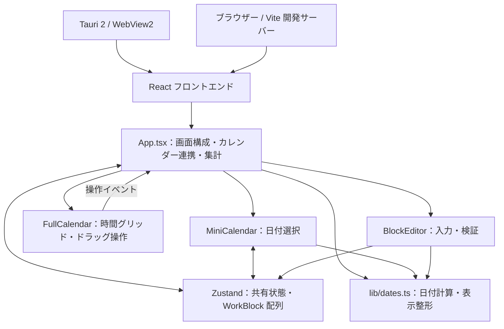

# DevScope アーキテクチャ

## 1. 目的と実装範囲

DevScope は、PSP（Personal Software Process）の考え方に基づき、ソフトウェア開発の予定と実績を記録・比較する Windows 向けアプリケーションです。現在はカレンダーを中心とした UI プロトタイプで、画面操作とメモリ上の状態管理までを実装しています。

ブラウザー版と Tauri 版は同じ React フロントエンドを使用します。Tauri の Rust コードはウィンドウの起動だけを担当し、業務処理・独自コマンド・永続化はありません。SQLite、Git 連携、AI 分析、予定と実績の自動対応付けは未実装です。

## 2. 全体構成

React コンポーネントの親子関係と状態の流れは [フロントエンド設計](docs/architecture/frontend.md) を参照してください。

Zustand が確定済みの作業データと共有する表示状態を保持します。FullCalendar にはストアから変換したイベントを渡し、編集操作をストアに戻します。FullCalendar の内部データを独立した保存先として扱いません。

## 3. 技術と責務

| 技術 | 現在の役割 |
| --- | --- |
| Tauri 2 | Windows ウィンドウの生成、ビルド済みフロントエンドの表示 |
| React 18 / TypeScript 5 | コンポーネント構成、入力処理、型定義。TypeScript は strict モード |
| Vite 6 | 開発サーバーと本番アセットの生成 |
| Tailwind CSS 3 / PostCSS | ユーティリティクラスの生成 |
| shadcn/ui 方式の UI 部品 / Radix UI | ボタン、ダイアログ、予定・実績／日・週の選択部品 |
| FullCalendar 6 | 日・週の時間グリッド、範囲選択、移動、リサイズ |
| Zustand 5 | 選択日・表示モード・フィルター・作業ブロックの共有 |
| lucide-react | 画面内のアイコン |
| Playwright | ブラウザー操作と日付計算のテスト |
| Husky / commitlint | コミットメッセージの形式検証 |

正確な依存バージョンは [package-lock.json](package-lock.json)、Rust 側は [Cargo.lock](src-tauri/Cargo.lock) で固定しています。

## 4. ディレクトリと主要ファイル

| パス | 責務 |
| --- | --- |
| [src/main.tsx](src/main.tsx) | React の起動。StrictMode 内で App を描画 |
| [src/App.tsx](src/App.tsx) | ヘッダー・サイドバー・集計の構成、FullCalendar との接続、編集対象の管理 |
| [src/components/MiniCalendar.tsx](src/components/MiniCalendar.tsx) | 6週・42日分の月間表示、月移動、選択日・選択週・今日の強調 |
| [src/components/BlockEditor.tsx](src/components/BlockEditor.tsx) | 作業ブロックの作成・編集・削除と入力検証 |
| `src/components/ui/` | Radix UI 等を使う共通部品。業務データへの依存は持たない |
| [src/store/calendar.ts](src/store/calendar.ts) | 作業データの型、カテゴリ定義、Zustand ストア |
| [src/data/demoBlocks.ts](src/data/demoBlocks.ts) | 初回表示用サンプルの定義（`demoBlockTemplates`）と生成処理（`createDemoBlocks`） |
| [src/lib/dates.ts](src/lib/dates.ts) | ローカル日付の変換、週・月の計算、期間と所要時間の表示 |
| [src/lib/utils.ts](src/lib/utils.ts) | clsx と tailwind-merge を使ったクラス名の統合 |
| [src/styles.css](src/styles.css) | 配色、レイアウト、画面幅への対応、FullCalendar の表示調整 |
| [components.json](components.json) | shadcn/ui の部品追加に使う設定とエイリアス |
| [src-tauri/src/main.rs](src-tauri/src/main.rs) | Tauri アプリケーションの起動 |
| [src-tauri/tauri.conf.json](src-tauri/tauri.conf.json) | ウィンドウ、開発 URL、配布アセット、CSP、アイコンの設定 |
| [public/devscope.svg](public/devscope.svg) | AI が SVG コードを生成して作成したアプリアイコン。生成元を SVG 内にも記載 |
| `src-tauri/icons/` | SVG から変換した Windows・Tauri 用の PNG / ICO |
| `tests/` | 日付計算とカレンダー操作のテスト |

`@/` は `src/` を指します。TypeScript と Vite の両方に同じエイリアスを設定しています。

## 5. データモデルと状態の所有者

### 作業ブロック

`WorkBlock` は予定または実績の1件を表します。

| フィールド | 内容 |
| --- | --- |
| `id` | 識別子。ユーザーが新規作成したブロックには `crypto.randomUUID()` で採番 |
| `title` | 作業名 |
| `start`, `end` | ローカル日時文字列 `YYYY-MM-DDTHH:mm` |
| `mode` | `plan`（予定）または `actual`（実績） |
| `category` | `development`、`design`、`review`、`meeting` |
| `project` | 任意のプロジェクト名。プロジェクトマスターへの参照ではない |
| `note` | 任意のメモ |

予定と実績は同じ配列内に保持し、`mode` で表示を絞り込みます。予定の編集を実績へ反映する処理や、予定から実績へ変換する処理はありません。

### 共有状態とローカル状態

| 所有者 | 状態 |
| --- | --- |
| Zustand | `date`（選択日）、`view`（日／週）、`mode`（予定／実績）、`sidebarOpen`、`visibleCategories`、`blocks` |
| App | `draft`（編集対象のコピー）、`announcement`（操作の読み上げ通知）、FullCalendar の参照 |
| MiniCalendar | `month`（ミニカレンダーで閲覧中の月） |
| BlockEditor | 保存前の入力内容と検証エラー |

初期状態は今日・週表示・予定・サイドバー表示・全カテゴリ表示です。起動時に、その週のサンプル予定と、終了時刻が起動時刻以前のサンプル実績を生成します。サンプルは時間経過に応じて自動追加されません。

サンプルの変更箇所は `src/data/demoBlocks.ts` の `demoBlockTemplates` です。各データは項目名付きのオブジェクトで記述し、曜日は月曜0〜日曜6、開始・終了時刻は `HH:mm` で指定します。ストアは同ファイルの `createDemoBlocks()` を初期化時に呼び出します。サンプル側はストアの型を `import type` で参照し、実行時にはストアを読み込みません。

ストアに永続化ミドルウェアはなく、localStorage、ファイル、データベースも使用しません。再読み込み・終了によって入力内容と表示状態は失われます。

## 6. 主要なデータフロー

### 日付と表示の同期

1. 今日・前後の期間・ミニカレンダーの操作が `setDate` を呼ぶ。
2. 日／週の切り替えが `setView` を呼ぶ。
3. App の effect が FullCalendar の `changeView` に表示形式と選択日を渡す。
4. MiniCalendar は共有の選択日が変わると、その日を含む月へ移動する。

ミニカレンダーだけの前月・翌月移動では、閲覧中の月のみ変更します。日付をクリックした時点でメインカレンダーへ反映します。メインカレンダーの日付見出しをクリックすると、その日の日表示に切り替わります。

### 作成・編集・削除

1. 追加ボタン、空き時間のクリック、範囲ドラッグで新規 `draft` を作る。追加ボタンの初期時刻は選択日の9時から1時間。
2. 既存ブロックのクリックでは、ID に対応するストア内の値を `draft` にコピーする。
3. BlockEditor はローカル状態で入力を保持し、保存時にタイトルと日時を検証する。
4. ID の有無に応じて `addBlock` / `updateBlock` を呼ぶ。削除は `deleteBlock` を呼ぶ。
5. ストアの更新から FullCalendar のイベント一覧と集計を再計算する。

キャンセルやダイアログを閉じる操作では、入力途中の値をストアへ反映しません。タイトルは空白だけを禁止し、日時は有効な正の所要時間になることを確認します。文字数制限は入力要素で設定しています。

これらの入力検証は現在 BlockEditor が担当し、ストアの更新関数自体には共通の検証処理がありません。別の入力経路を追加するときは、この責務も見直す必要があります。

### ドラッグ移動・時間変更

FullCalendar の `eventChange` を App が受け、開始・終了をローカル日時文字列へ変換して `updateBlock` を呼びます。開始・終了が取得できない場合は `revert()` で操作を戻します。変更後は `aria-live` 領域へ通知します。

時間グリッドは30分刻み、ドラッグ操作のスナップは15分刻みです。フォームの日時入力には15分刻みの制約を設けていません。重なるブロックは許可し、カレンダーでは横に並べて表示します。

## 7. 日付・時刻と集計の規則

- 実行端末のローカル時間を使用する。日本語表示とタイムゾーンは別の設定であり、アプリ本体は Asia/Tokyo に固定していない。
- 選択日は `YYYY-MM-DD`、作業日時はタイムゾーン情報を含まない `YYYY-MM-DDTHH:mm` で保持する。
- `fromKey` は年月日からローカル午前0時を作る。日付だけの文字列を UTC として解釈することを避ける。
- 週は月曜始まりの7日間。日表示・週表示とも表示期間は開始を含み終了を含まない範囲として扱う。
- 集計対象は、選択中の予定／実績、表示カテゴリ、表示期間に重なるブロック。
- 期間をまたぐブロックの時間は、表示期間内の部分だけを加算する。件数は重なるブロックを1件として数える。
- 重なる作業時間もブロックごとに加算するため、集計値は占有時間の和集合ではない。

集計は App 内で算出する派生値で、ストアには保存しません。共有や永続化を導入する場合は、タイムゾーンの保持方法も別途設計する必要があります。

## 8. 表示とネイティブ機能の境界

共通 UI 部品は `src/components/ui/` で管理します。Radix UI がダイアログや選択部品のフォーカス・キーボード操作を支え、Tailwind と `styles.css` が見た目を担当します。FullCalendar 固有の CSS 調整は `styles.css` に集約しています。

プロジェクト管理とインサイトは「準備中」の表示だけで、操作・画面遷移は実装していません。現在はルーターも使用していません。

Rust の起動処理には `invoke_handler` や独自プラグインを登録しておらず、フロントエンドにも Tauri API 呼び出しはありません。ブラウザーで同じ機能を検証できます。CSP は `tauri.conf.json` に設定し、表示に必要なインラインスタイル等を許可しています。

## 9. 開発・ビルド・検証

| コマンド | 処理 |
| --- | --- |
| `mise run dev` | Vite を1420番ポートで起動。使用中なら別ポートへ自動変更せず失敗 |
| `mise run build` | TypeScript の型検査後に Vite が `dist/` を生成。FullCalendar 関連は別チャンクに分割 |
| `mise run tauri:dev` | Vite を起動し、Tauri が開発 URL を表示 |
| `mise run tauri:build` | フロントエンドをビルドし、Windows デバッグ実行ファイルを生成 |
| `mise run rust:check` | Rust 側のコンパイル確認 |
| `mise run test` | 日付計算とブラウザー操作の全テスト |
| `mise run test:e2e` | カレンダーのブラウザー操作テスト |

Tauri の配布対象は `dist/` です。現在は `bundle.active` が false で、インストーラーを生成しません。`dist/`、Rust の `target/`、Tauri が生成するスキーマ、テスト成果物は Git の追跡対象から除外しています。

Playwright はインストール済みの Google Chrome を使用します。テスト環境は日本語・Asia/Tokyo とし、カレンダー操作のテストでは日時を固定します。日付計算では週・月・年の境界を確認し、画面では CRUD、モード分離、フィルター、日付同期、ドラッグ操作、再読み込み時のリセット、画面幅と実行時エラーを検証します。ネイティブ WebView2 の操作テストではありません。

`mise run setup` / `mise exec -- npm install` の `prepare` で Husky を有効化し、`commit-msg` で commitlint を実行します。`defaultIgnores: false` のため、merge・fixup メッセージも検証対象です。

## 10. 今後の拡張時に検討する境界

以下は将来の設計上の検討事項であり、現在の実装には含まれません。

- 永続化は画面から直接呼ばず、読み書きの責務を分離した上でストアと接続する。非同期処理の成功・失敗と初期読み込みの状態も設計する。
- 複数の入力元を追加する場合は、作業ブロックの検証を共有し、画面ごとの検証差異を避ける。
- SQLite や Git などのネイティブ機能を追加する場合は、Rust コマンドと権限を明示し、UI との受け渡しの型を定義する。
- 予定と実績の比較を追加する場合は、対応関係・差分の算出規則を先に決める。現在の `mode` だけでは両者の対応関係を表現できない。

起動手順と利用方法は [README.md](README.md) を参照してください。
