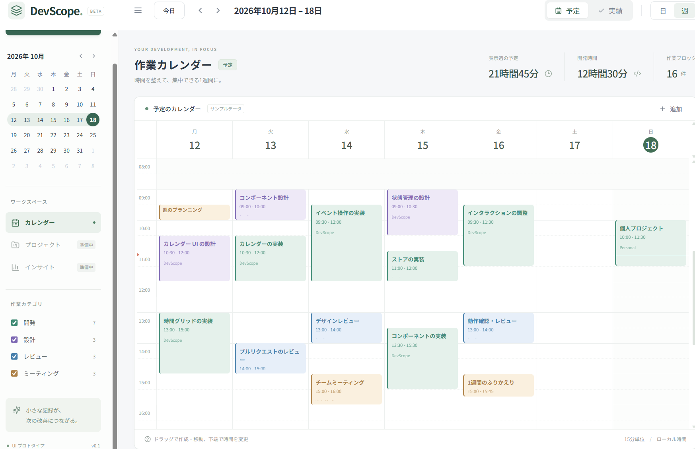

# devscope

DevScope は PSP の考え方に基づいて作業の予定と実績を記録する、Windows 向けデスクトップアプリの UI プロトタイプです。

構成・状態管理・データの流れは [ARCHITECTURE.md](ARCHITECTURE.md) を参照してください。
React のコンポーネント図と各部品の責務は [フロントエンド設計](docs/architecture/frontend.md) に記載しています。

開発時は [Codex の作業指針](AGENTS.md) に従い、[開発計画](docs/development-plan.md)、[設計判断（ADR）](docs/adr/README.md)、[依存・素材の記録](docs/provenance.md) を更新してください。

## アイコンについて

**AI生成アイコン**：[`public/devscope.svg`](public/devscope.svg) は、Codex が SVG コードを生成して作成したものです。
Tauri 用の `src-tauri/icons/icon.png`・`icon.ico` も、この AI 生成アイコンから変換しています。

## スクリーンショット




## 起動とビルド

mise をインストールし、Node.js 18.17 以降と npm を利用できる環境を用意してください。開発・テスト・ビルドは [mise.toml](mise.toml) のタスク経由で実行します。既存環境に合わせて Vite 6・Tailwind CSS 3 を使用しています。

各タスクには日本語の説明を付けています。リポジトリのルートで次のコマンドを実行するとヘルプを確認できます。

```sh
mise run help          # 開発コマンドと説明の一覧（mise tasks と同じ）
mise tasks info test   # test タスクの説明・実行内容
mise run --help        # mise のタスク実行オプション
```

タスク定義の形式は [mise 公式ドキュメント](https://mise.jdx.dev/tasks/toml-tasks.html) を参照してください。

```sh
mise run setup
mise run dev
```

ブラウザーでは `http://localhost:1420` を開きます。

```sh
mise run build
mise run preview
```

Windows デスクトップ版は Rust、Visual Studio の C++ ビルドツール、WebView2 を導入した環境で起動します。

```sh
mise run tauri:dev
mise run tauri:build
```

後者は `src-tauri/target/debug/devscope.exe` を生成します。インストーラーの生成は対象外です。
`src-tauri` はウィンドウを起動するだけの最小構成で、独自の Rust コマンドやバックエンド処理はありません。

## プロトタイプでできること

- 月曜始まりの7日間表示／日表示、今日・前後の期間への移動
- 月間ミニカレンダーの日付選択とメイン画面の同期、選択週・今日の強調
- サイドバーの開閉、作業カテゴリによる表示の絞り込み
- 予定／実績の切り替え。それぞれの時間ブロックを独立して管理
- 空き時間のクリック・ドラッグまたは追加ボタンによる作成
- ブロックのクリックによる編集・削除、ドラッグによる移動、下端のドラッグによる時間変更（15分単位）
- 作業名・開始終了日時・カテゴリ・プロジェクト・メモの入力、日時の検証
- 表示期間とカテゴリに応じた時間・件数の集計

初回表示の週にはサンプルの予定と過去時刻の実績を用意しています。
サンプルを変更する場合は、[`src/data/demoBlocks.ts`](src/data/demoBlocks.ts) の `demoBlockTemplates` を編集してください。
各項目に曜日（`weekday`: 月曜0〜日曜6）、開始・終了時刻、作業名、カテゴリ、プロジェクトを記載しています。
Zustand のメモリ上だけで管理し、再読み込み・アプリの終了で変更はリセットされます。
SQLite、ファイル保存、Git 連携、AI 分析は実装していません。
プロジェクト管理・インサイトは「準備中」として表示し、操作できません。

## 構成とテスト

`src/App.tsx` がカレンダー画面、`src/store/calendar.ts` が状態管理、`src/data/demoBlocks.ts` がサンプルデータと生成処理、
`src/components` がミニカレンダー・編集ダイアログ・shadcn/ui 方式の Radix UI 部品です。
`components.json` と Tailwind の設定を含めています。

Google Chrome をインストールした環境で次を実行してください。

```sh
mise run test
```

Playwright が開発サーバーを起動し、日付計算・日週の同期・入力検証・CRUD・モード分離・再読み込み時のリセット・ドラッグ操作・画面サイズを検証します。
`test-results/devscope-desktop.png` に画面のスクリーンショットを出力します。

依存監査では実行時依存の指摘は0件です。Node.js 18 と互換性のある Tailwind CSS 3 の開発用依存には7件の指摘が残っています。

## 開発環境のセットアップ

Git と mise、Node.js 18.17 以降、npm を用意し、リポジトリのルートで次を実行してください。

```sh
mise run setup
```

`prepare` スクリプトで Husky の Git フックを自動的に有効化します。
クローンごとに実行してください。

## コミットメッセージ

[Husky](https://typicode.github.io/husky/) の `commit-msg` フックで
[commitlint](https://commitlint.js.org/) を実行し、Conventional Commits 形式を検証します。
形式が不正な場合、コミットは失敗します。

```text
<type>[(scope)][!]: <description>
```

使用できる type は `feat`, `fix`, `docs`, `style`, `refactor`, `perf`,
`test`, `build`, `ci`, `chore`, `revert` です。scope と `!` は任意で、説明は日本語でも記述できます。

```text
chore: 開発環境とビルド成果物の除外設定を追加
feat(ui): ダッシュボードを追加
fix(api)!: レスポンス形式を修正
```

通常の merge メッセージや `fixup!` メッセージも検証対象です。
マージする場合も `chore: ブランチをマージ` などの形式を使用してください。

既存のメッセージファイルを手動で検証する場合は、次を実行します。

```sh
mise exec -- npm run commitlint -- --edit .git/COMMIT_EDITMSG
```
