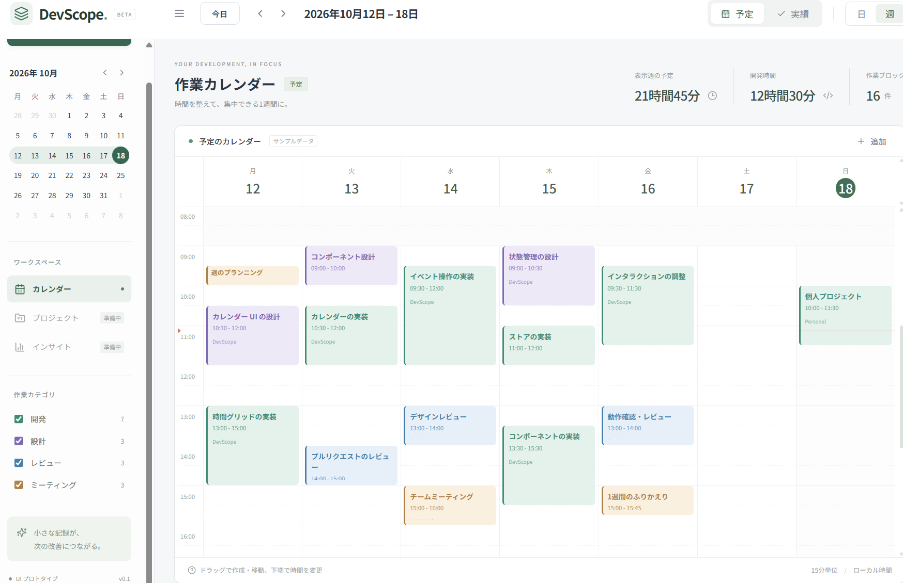

# devscope

DevScope は PSP の考え方に基づいて作業の予定と実績を記録する、Windows 向けデスクトップアプリです。現在はカレンダーとローカル保存を実装しています。

構成・状態管理・データの流れは [ARCHITECTURE.md](ARCHITECTURE.md) を参照してください。
React のコンポーネント図と各部品の責務は [フロントエンド設計](docs/architecture/frontend.md) に記載しています。
バックエンドのコマンド・入力・エラー・保存仕様は [作業ブロック API](docs/api/work-blocks.md) を参照してください。

開発時は [Codex の作業指針](AGENTS.md) に従い、[開発計画](docs/development-plan.md)、[設計判断（ADR）](docs/adr/README.md)、[依存・素材の記録](docs/provenance.md) を更新してください。

## アイコンについて

**AI生成アイコン**：[`public/devscope.svg`](public/devscope.svg) は、Codex が SVG コードを生成して作成したものです。
Tauri 用の `src-tauri/icons/icon.png`・`icon.ico` も、この AI 生成アイコンから変換しています。

## スクリーンショット




## 起動とビルド

mise をインストールし、Node.js 18.17 以降と npm を利用できる環境を用意してください。開発・テスト・ビルドは [mise.toml](mise.toml) のタスク経由で実行します。既存環境に合わせて Vite 6・Tailwind CSS 3 を使用しています。

各タスクには日本語の説明を付けています。リポジトリのルートで次のコマンドを実行するとヘルプを確認できます。

```sh
mise run help          # 開発コマンドと説明の一覧（mise tasks と同じ）
mise tasks info test   # test タスクの説明・実行内容
mise run --help        # mise のタスク実行オプション
```

タスク定義の形式は [mise 公式ドキュメント](https://mise.jdx.dev/tasks/toml-tasks.html) を参照してください。

```sh
mise run setup
mise run dev
```

ブラウザーでは `http://localhost:1420` を開きます。

```sh
mise run build
mise run preview
```

Windows デスクトップ版は Rust 1.89 以降、Visual Studio の C++ ビルドツール、WebView2 を導入した環境で起動します。

```sh
mise run tauri:dev
mise run tauri:build
```

後者は `src-tauri/target/debug/devscope.exe` を生成します。インストーラーの生成は対象外です。
`src-tauri` はウィンドウ起動と作業ブロックの取得・作成・更新・削除、入力検証、JSON ファイルへの保存を担当します。

## プロトタイプでできること

- 月曜始まりの7日間表示／日表示、今日・前後の期間への移動
- 月間ミニカレンダーの日付選択とメイン画面の同期、選択週・今日の強調
- サイドバーの開閉、作業カテゴリによる表示の絞り込み
- 予定／実績の切り替え。それぞれの時間ブロックを独立して管理
- 「比較」で各日の予定・実績を同じ時間軸で並べ、日／週の合計とタスク・プロジェクト・工程別の時間差分を表示
- 空き時間のクリック・ドラッグまたは追加ボタンによる作成
- ブロックのクリックによる編集・削除、ドラッグによる移動、下端のドラッグによる時間変更（15分単位）
- タスク登録画面で作業名・カテゴリ・プロジェクトを事前登録し、予定・実績の追加時に選択
- タスク登録画面から開発工程・プロジェクト・作業カテゴリの登録画面を開き、登録した名前をタスクで選択
- 各登録画面で一覧を確認し、タスクや未使用の開発工程・プロジェクト・作業カテゴリを削除
- 開始終了日時・カテゴリ・プロジェクト・メモの入力、日時の検証
- 表示期間とカテゴリに応じた時間・件数の集計
- カレンダー下部のデバッグ用ボタンから、表示中の週へサンプルを追加（デスクトップ対応）

ヘッダーの「タスク登録」で作業を登録し、カレンダーの「予定を作成」でタスクと日時を選択します。入力途中でも「タスク登録へ」から追加でき、戻ると日時・メモを維持します。タスク一覧の削除ボタンで候補を削除できます。登録済みの予定・実績は残り、「現在の作業」として編集できます。タスク名の編集は未実装です。

ヘッダーの「比較」では、日ごとに左が予定・右が実績のカレンダーを表示します。日／週の切り替え、日付移動とカテゴリの絞り込みは両方に適用します。下部の表は「タスク／プロジェクト／工程」で集計軸を切り替え、差分は「実績 − 予定」で表示します。期間外の時間は集計せず、予定だけ・実績だけの作業や未指定項目も表示します。タスク軸では同名の作業を合算します。比較は閲覧専用で、編集時は予定・実績へ切り替えてください。狭い画面では時間軸内を横スクロールできます。

タスク登録画面の「開発工程を登録」「プロジェクトを登録」「作業カテゴリを登録」から、それぞれ名前を登録できます。「タスク登録に戻る」で入力途中のタスクを保ち、登録した名前を選択した状態で戻ります。各画面の一覧には削除ボタンがあります。タスクや予定・実績で使用中の項目は理由を表示して削除を止めます。名前の編集は未実装です。過去に入力したプロジェクト名も選択候補に含まれます。開発工程は要件定義・実装・テストなどの任意項目で、色分け・絞り込み用の作業カテゴリとは別です。

デスクトップ版は初回は空のカレンダー・タスク・開発工程・プロジェクト一覧と初期4カテゴリで起動し、作業データ・登録と削除の結果をアプリデータディレクトリの `work-blocks.json` に保存します。アプリ終了後も復元します。
保存に失敗した場合はエラーを表示し、フォームの入力を保持します。ドラッグ・リサイズの失敗時は元に戻します。
ブラウザー版では初回表示の週にサンプルの予定と過去時刻の実績を用意しています。
デスクトップ版でサンプルを表示する場合は、カレンダー下部右側の小さな「サンプルデータを読み込む」を押してください。表示中の日付を含む週へ予定・終了済みの実績とタスクを追加し、予定の週表示に切り替えます。既存の作業は残り、同一内容は重複追加しません。不足している初期カテゴリも補います。デスクトップでは追加結果を通常のデータとして保存するため、再起動後も残ります。編集済みのサンプルの元の内容を再読み込みした場合は別件として追加されます。
サンプルを変更する場合は、[`src/data/demoBlocks.ts`](src/data/demoBlocks.ts) の `demoBlockTemplates` を編集してください。
各項目に曜日（`weekday`: 月曜0〜日曜6）、開始・終了時刻、作業名、カテゴリ、プロジェクトを記載しています。
ブラウザー版は Zustand とデモ用アダプターのメモリ上で管理し、再読み込みで変更はリセットされます。表示状態（日付・フィルターなど）はデスクトップ版でも保存しません。
SQLite、Git 連携、AI 分析は実装していません。
サイドバーのプロジェクト管理・インサイトは「準備中」です。プロジェクト名の登録はタスク登録画面から利用できます。

## 構成とテスト

`src/App.tsx` がカレンダー画面、`src/store/calendar.ts` が状態管理、`src/data/demoBlocks.ts` がサンプルデータと生成処理、
`src/components` がタスク登録画面・ミニカレンダー・編集ダイアログ・shadcn/ui 方式の Radix UI 部品です。`src/lib/workBlocksApi.ts` が通信境界、`src-tauri/src/blocks.rs` がバックエンド API と永続化を担当します。
`components.json` と Tailwind の設定を含めています。

Google Chrome をインストールした環境で次を実行してください。

```sh
mise run test
```

Playwright が開発サーバーを起動し、日付計算・日週の同期・入力検証・CRUD・モード分離・再読み込み時のリセット・ドラッグ操作・画面サイズを検証します。
Tauri 通信をモックしたテストでは API 接続・復元・読み込みと保存の失敗・再試行も検証します。実際の WebView2 操作ではありません。
Rust API の実ファイル保存・復元・入力検証・期間境界・破損・排他は `mise run rust:test`、コンパイルは `mise run rust:check` で確認します。
`test-results/devscope-desktop.png` に画面のスクリーンショットを出力します。

依存監査では実行時依存の指摘は0件です。Node.js 18 と互換性のある Tailwind CSS 3 の開発用依存には7件の指摘が残っています。

## 開発環境のセットアップ

Git と mise、Node.js 18.17 以降、npm を用意し、リポジトリのルートで次を実行してください。

```sh
mise run setup
```

`prepare` スクリプトで Husky の Git フックを自動的に有効化します。
クローンごとに実行してください。

## コミットメッセージ

[Husky](https://typicode.github.io/husky/) の `commit-msg` フックで
[commitlint](https://commitlint.js.org/) を実行し、Conventional Commits 形式を検証します。
形式が不正な場合、コミットは失敗します。

```text
<type>[(scope)][!]: <description>
```

使用できる type は `feat`, `fix`, `docs`, `style`, `refactor`, `perf`,
`test`, `build`, `ci`, `chore`, `revert` です。scope と `!` は任意で、説明は日本語でも記述できます。

```text
chore: 開発環境とビルド成果物の除外設定を追加
feat(ui): ダッシュボードを追加
fix(api)!: レスポンス形式を修正
```

通常の merge メッセージや `fixup!` メッセージも検証対象です。
マージする場合も `chore: ブランチをマージ` などの形式を使用してください。

既存のメッセージファイルを手動で検証する場合は、次を実行します。

```sh
mise exec -- npm run commitlint -- --edit .git/COMMIT_EDITMSG
```
