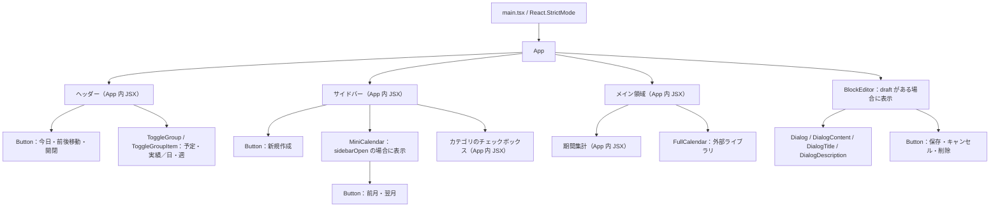
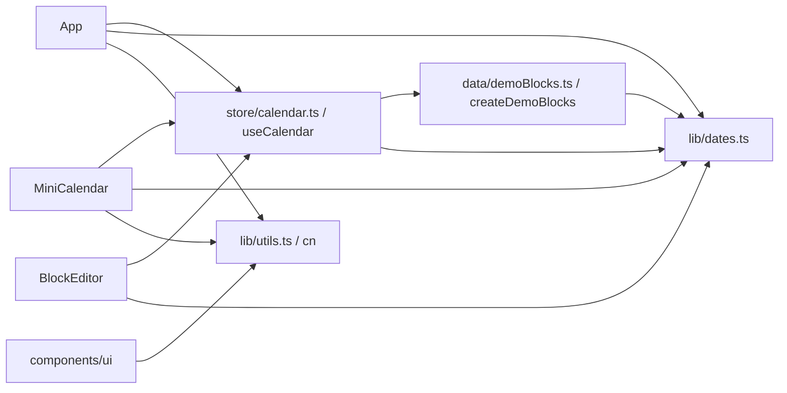
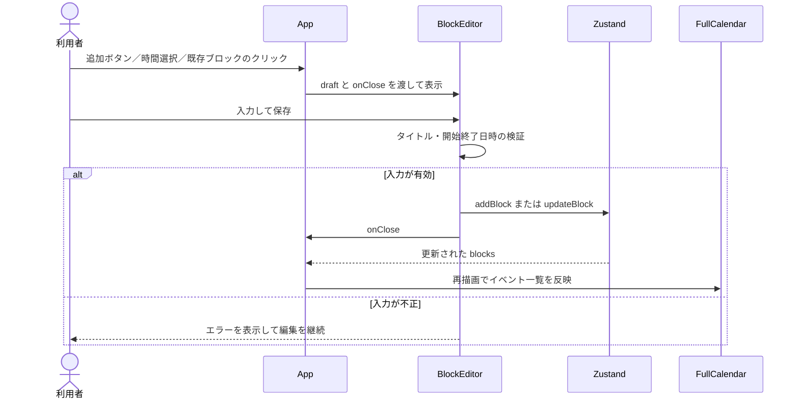

# フロントエンド設計

この資料は、現在実装されている React フロントエンドの構成と、コンポーネント間のデータの流れを説明します。
Tauri を含む全体構成、データモデル、ビルド構成は [ARCHITECTURE.md](../../ARCHITECTURE.md) を参照してください。

## 1. コンポーネント構成図

矢印は描画上の親子関係です。「App 内 JSX」と記載した領域は、独立したコンポーネントには分割していません。



画面全体を組み立てるのは [App.tsx](../../src/App.tsx) です。現在は単一画面で、ルーターや別ページへの遷移はありません。

## 2. コンポーネントの責務

| コンポーネント | 責務 | 入出力・依存 |
| --- | --- | --- |
| [App](../../src/App.tsx) | ヘッダー・サイドバー・集計の描画、FullCalendar との接続、編集対象の保持 | Zustand を参照・更新。`draft` と `onClose` を BlockEditor に渡す |
| [MiniCalendar](../../src/components/MiniCalendar.tsx) | 6週分の月間カレンダー、閲覧月の切り替え、今日・選択日・対象週の強調 | Zustand の `date`・`view` を参照し、日付選択で `setDate` を呼ぶ |
| [BlockEditor](../../src/components/BlockEditor.tsx) | 入力フォーム、検証、新規追加・編集・削除 | `draft: Draft`、`onClose: () => void` を受け取り、ストアの更新関数を呼ぶ |
| FullCalendar | 日・週の時間グリッド、範囲選択、ドラッグ移動、リサイズ | App からイベント一覧を受け取り、操作をコールバックで返す |
| [Button](../../src/components/ui/button.tsx) | 共通ボタンの見た目、variant、size、`asChild` の提供 | Radix Slot、class-variance-authority、`cn` を使用 |
| [ToggleGroup / ToggleGroupItem](../../src/components/ui/toggle-group.tsx) | 単一選択の切り替え UI | Radix Toggle Group を使用。選択値の保持は App 経由でストアが担当 |
| [Dialog 関連部品](../../src/components/ui/dialog.tsx) | モーダル、オーバーレイ、見出し、説明、閉じる操作 | Radix Dialog を使用。フォームや保存処理は BlockEditor が担当 |

`src/components/ui/` の共通部品は作業データや Zustand に依存しません。カテゴリの名前と色はストア側の `categories` に定義しています。

## 3. 状態とモジュールの依存関係

次の矢印は、描画の親子関係ではなく、実行時に参照するモジュールの方向を表します。



サンプルデータ側の `Category`・`WorkBlock` は `import type` で参照しています。実行時にサンプルデータ側からストアを読み込む依存はありません。

| 所有者 | 保持する状態 | 保持期間 |
| --- | --- | --- |
| Zustand | `date`、`view`、`mode`、`sidebarOpen`、`visibleCategories`、`blocks` | アプリのセッション中 |
| App | `draft`、操作通知の `announcement` | App が描画されている間。`draft` は編集終了時に破棄 |
| MiniCalendar | 閲覧中の `month` | コンポーネントが描画されている間 |
| BlockEditor | 保存前の `form`、検証エラーの `error` | ダイアログを開いている間 |

App は FullCalendar の参照も `useRef` で保持し、表示切り替えとサイズ再計算に使います。
サイドバーを閉じると MiniCalendar はアンマウントされるため、再度開いた際の閲覧月は選択日から初期化されます。

## 4. 主要な操作の流れ

### 日付・表示モードの変更

ヘッダーまたは MiniCalendar の操作でストアの `date`・`view` を更新すると、App が FullCalendar の `changeView` を呼びます。MiniCalendar は選択日が変わると、その日を含む月へ表示を同期します。

MiniCalendar の前月・翌月ボタンは、ローカル状態の `month` のみを更新します。日付を選ぶまで、メインカレンダーの表示日は変わりません。

予定／実績の切り替えとカテゴリのチェック操作は、イベント一覧と期間集計の絞り込みに反映します。ストア内の元データを削除する操作ではありません。

### 作業ブロックの作成・編集



`Draft` は `BlockInput & { id?: string }` です。ID がある場合は既存ブロックを編集し、ない場合は新規追加します。フォーム入力は保存するまでローカルに保持し、キャンセル時は破棄します。

作業名は空白だけを禁止し、日時は有限かつ正の所要時間になることを検証します。削除は既存 ID で `deleteBlock` を呼びます。ストアの更新関数自体には入力検証がないため、別の入力経路を追加する際は検証の共有を検討してください。

### 移動・リサイズ

FullCalendar の `eventChange` → App の `changeEvent` → `updateBlock` の順で反映します。開始・終了日時を取得できない場合は `revert()` で操作を戻します。ダイアログを開く操作はありません。

グリッドは30分刻み、ドラッグのスナップは15分刻みです。フォームの日時入力は15分刻みに制限していません。重なる作業は横に並べて表示します。

## 5. 描画用データと集計

- 確定した作業データは Zustand の `blocks` が保持する。FullCalendar へ渡すイベントは毎回ここから変換する。
- App は `mode` と `visibleCategories` でイベントを絞り込む。表示期間内のイベント描画は FullCalendar が担当する。
- 集計では、さらに表示期間と重なるブロックに絞る。期間外の時間を切り落として、合計時間・開発時間・件数を算出する。
- 集計値は派生値として App 内で計算し、ストアに重複して保存しない。重なる作業時間はブロックごとに加算する。
- 日付は実行端末のローカル時間で扱う。`date` は `YYYY-MM-DD`、作業日時は `YYYY-MM-DDTHH:mm` とし、変換を [dates.ts](../../src/lib/dates.ts) にまとめる。

初期データの定義と生成処理は [demoBlocks.ts](../../src/data/demoBlocks.ts) にあります。表示するサンプルを変更する場合は `demoBlockTemplates` を編集してください。現時点でテスト DB への投入処理はありません。

## 6. スタイルとアクセシビリティ

共通部品には Tailwind のユーティリティクラスを使い、画面レイアウト・レスポンシブ対応・FullCalendar の見た目は [styles.css](../../src/styles.css) に定義しています。[components.json](../../components.json) は shadcn/ui 方式の部品追加に使う設定です。

Radix UI が選択部品やダイアログのキーボード・フォーカス操作を支えます。アイコンだけのボタンには `aria-label` を付け、移動・リサイズの完了は `aria-live` 領域で通知します。未実装のプロジェクト管理とインサイトは `aria-disabled` を付けた「準備中」の表示です。

## 7. 実装上の境界と検証

フロントエンドから Rust コマンドや外部 API を呼び出す処理はありません。Zustand の状態はメモリ上のみで、再読み込み・アプリ終了で失われます。

[calendar.spec.ts](../../tests/calendar.spec.ts) は日週の同期、CRUD、入力検証、予定／実績の分離、カテゴリ、サイドバー、ドラッグ、再読み込み、画面サイズと実行時エラーを検証します。[dates.spec.ts](../../tests/dates.spec.ts) は日付計算と期間表示を検証します。

```sh
mise run build
mise run test
```

テストは Google Chrome 上のフロントエンドを対象とし、Tauri のネイティブウィンドウを直接操作しません。
コンポーネントの分割や状態の所有者を変更した場合は、この資料の図・責務表も同じ変更で更新してください。
