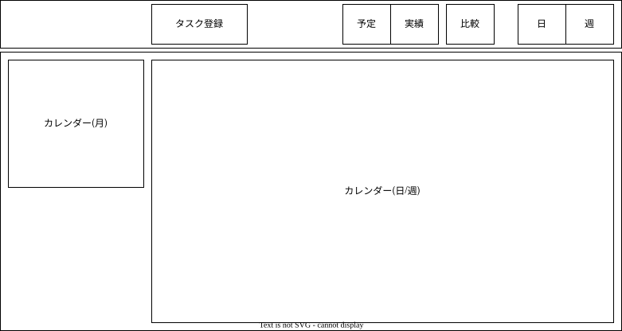
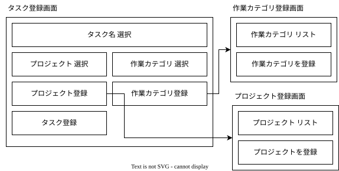

# フロントエンド構成

## 目的・対象範囲

TBD

## UI の構成と責務

TBD

## 状態管理

<!-- 各状態の所有者、共有範囲、更新方法を記載する。 -->

TBD

## データの流れ

<!-- 操作から保存・再表示までの流れを記載する。 -->

TBD

## API・保存層との境界

TBD

## 読み込み・エラーの扱い

TBD

## 検証方針

TBD

## 未決事項

TBD

## 関連ドキュメント

- [メイン画面](../specs/main-screen.md)
- [API・保存・エラーの契約](../api/work-blocks.md)
- [設計判断](../adr/README.md)
