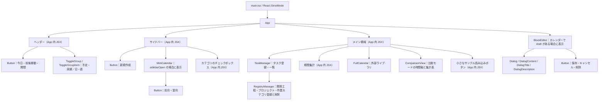
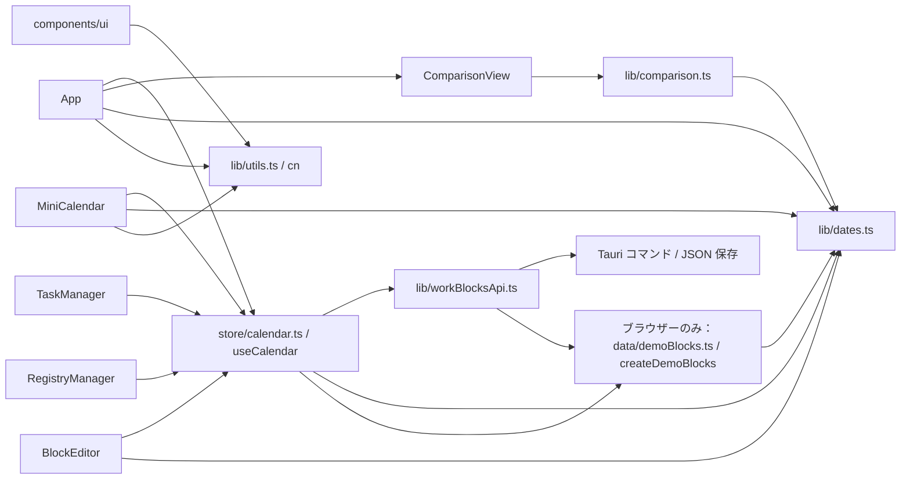
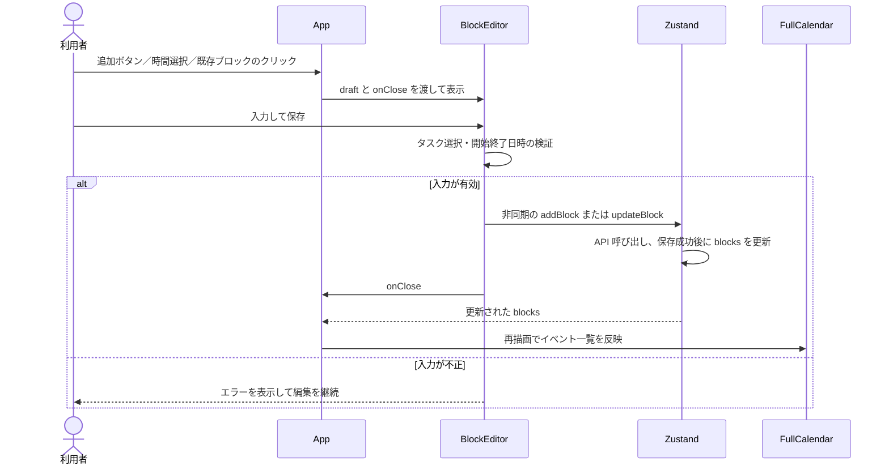

# フロントエンド設計

この資料は、現在実装されている React フロントエンドの構成と、コンポーネント間のデータの流れを説明します。
Tauri を含む全体構成、データモデル、ビルド構成は [ARCHITECTURE.md](../../ARCHITECTURE.md) を参照してください。

## 1. コンポーネント構成図

矢印は描画上の親子関係です。「App 内 JSX」と記載した領域は、独立したコンポーネントには分割していません。



画面全体を組み立てるのは [App.tsx](../../src/App.tsx) です。App のローカル状態 `screen` でカレンダーとタスク登録画面を切り替えます。ルーターは追加していません。登録画面へ移る際に編集中の draft を App へ戻し、復帰時に日時・メモを引き継ぎます。

## 2. コンポーネントの責務

| コンポーネント | 責務 | 入出力・依存 |
| --- | --- | --- |
| [App](../../src/App.tsx) | ヘッダー・サイドバー・集計の描画、FullCalendar との接続、編集対象の保持 | Zustand を参照・更新。`draft` と `onClose` を BlockEditor に渡す |
| [MiniCalendar](../../src/components/MiniCalendar.tsx) | 6週分の月間カレンダー、閲覧月の切り替え、今日・選択日・対象週の強調 | Zustand の `date`・`view` を参照し、日付選択で `setDate` を呼ぶ |
| [BlockEditor](../../src/components/BlockEditor.tsx) | タスク選択、検証、新規追加・編集・削除、保存失敗時の入力保持 | `draft`、`onClose`、`onRegisterTask` を受け取り、ストアの非同期更新を待つ |
| [ComparisonView](../../src/components/ComparisonView.tsx) | 閲覧専用の予定・実績並列表示、合計・時間差分表 | App から日付・表示形式・絞り込み済みブロック・カテゴリ定義を受け取る。集計軸とスクロール参照だけをローカルに保持 |
| [TaskManager](../../src/components/TaskManager.tsx) | タスク登録・一覧・削除、失敗時の入力保持 | ストアの `tasks`・`categories`、非同期 `addTask` / `deleteTask` を使用。`onBack` でカレンダーへ戻る |
| [RegistryManager](../../src/components/RegistryManager.tsx) | 開発工程・プロジェクト・カテゴリの登録・一覧・削除、失敗時の入力保持 | `kind`、`onBack`、`onCreated`、`onDeleted`。ストアの登録・削除操作を使用 |
| FullCalendar | 日・週の時間グリッド、範囲選択、ドラッグ移動、リサイズ | App からイベント一覧を受け取り、操作をコールバックで返す |
| [Button](../../src/components/ui/button.tsx) | 共通ボタンの見た目、variant、size、`asChild` の提供 | Radix Slot、class-variance-authority、`cn` を使用 |
| [ToggleGroup / ToggleGroupItem](../../src/components/ui/toggle-group.tsx) | 単一選択の切り替え UI | Radix Toggle Group を使用。選択値の保持は App 経由でストアが担当 |
| [Dialog 関連部品](../../src/components/ui/dialog.tsx) | モーダル、オーバーレイ、見出し、説明、閉じる操作 | Radix Dialog を使用。フォームや保存処理は BlockEditor が担当 |

`src/components/ui/` の共通部品は作業データや Zustand に依存しません。カテゴリの名前と色はストアの `categories` で保持し、API から取得します。旧データ・初回起動の初期定義は `src/data/defaultCategories.ts` に置きます。

## 3. 状態とモジュールの依存関係

次の矢印は、描画の親子関係ではなく、実行時に参照するモジュールの方向を表します。



サンプルデータ側の `Category`・`WorkBlock` は `import type` で参照しています。実行時にサンプルデータ側からストアを読み込む依存はありません。

| 所有者 | 保持する状態 | 保持期間 |
| --- | --- | --- |
| Zustand | `date`、`view`、`mode`、`sidebarOpen`、`visibleCategories`、`blocks`、`tasks` | アプリのセッション中 |
| Zustand | `loadState`、`loadError`、`saving` | 読み込み・保存中の状態。保存成功後の戻り値を `blocks` / `tasks` に反映 |
| App | `screen`、`draft`、操作通知の `announcement` | App が描画されている間。`draft` は編集終了時に破棄 |
| MiniCalendar | 閲覧中の `month` | コンポーネントが描画されている間 |
| BlockEditor / TaskManager | 保存前の `form`、検証エラーの `error` | 各画面の表示中。登録画面へ移る際はブロック入力を App に戻す |
| Zustand | `phases`、`projects` | 保存成功済みの開発工程・プロジェクト候補 |
| Zustand | `categories` | 保存成功済みのカテゴリ ID と名称・配色の対応 |
| TaskManager | `registry`（開いている登録画面） | TaskManager の描画中。登録画面の表示中もタスクフォームを非表示で保持 |
| RegistryManager | 名前・エラー・保存通知 | 開発工程またはプロジェクトの登録画面を開いている間 |
| ComparisonView | 集計軸（タスク／プロジェクト／工程）、時間軸のスクロール参照 | 比較画面の表示中。集計値・カレンダーイベントは保存しない |

App は FullCalendar の参照も `useRef` で保持し、表示切り替えとサイズ再計算に使います。
サイドバーを閉じると MiniCalendar はアンマウントされるため、再度開いた際の閲覧月は選択日から初期化されます。

## 4. 主要な操作の流れ

### 日付・表示モードの変更

ヘッダーまたは MiniCalendar の操作でストアの `date`・`view` を更新すると、App が FullCalendar の `changeView` を呼びます。MiniCalendar は選択日が変わると、その日を含む月へ表示を同期します。

MiniCalendar の前月・翌月ボタンは、ローカル状態の `month` のみを更新します。日付を選ぶまで、メインカレンダーの表示日は変わりません。

予定／実績の切り替えとカテゴリのチェック操作は、イベント一覧と期間集計の絞り込みに反映します。ストア内の元データを削除する操作ではありません。

「比較」は両モードを対象にします。日表示では2列、週表示では各曜日に予定・実績の2列ずつを隣接させ、1つのスクロール領域で表示します。日付とカテゴリは通常表示と共有し、日付見出しを押すとその日の比較へ移ります。通常表示の編集は FullCalendar、閲覧専用の比較は CSS Grid の時間軸を使います。新しいカレンダー依存やネイティブ API は追加しません。
下部の内訳は同名タスク・プロジェクト・工程ごとの「予定／実績／実績 − 予定」を表示し、未指定と片側のみの作業も含みます。時間は表示期間内に切り詰め、重なる作業は別件として加算します。比較時は作成・編集・移動・リサイズを提供せず、通常表示に戻って編集します。[ADR 0006](../adr/0006-calendar-comparison.md) を参照してください。

### 作業ブロックの作成・編集

タスク登録画面から「開発工程を登録」「プロジェクトを登録」「作業カテゴリを登録」で RegistryManager を開きます。既存のタスク入力は保持し、保存成功時は候補をストアへ反映するとともにタスクフォームの選択値を更新します。「タスク登録に戻る」で入力を引き継いで戻ります。名前は trim 後1〜60 UTF-16コード単位で、同じ一覧内の重複は拒否します。
各登録画面の一覧に削除ボタンを表示します。使用中の分類は API が拒否し、エラーを表示して一覧を維持します。未保存フォームの選択項目を削除した場合、工程・プロジェクトは未指定へ、カテゴリは残った先頭候補へ切り替えます。タスク削除は予定・実績を変更しません。保存中は登録・削除・戻る操作を無効化します。
タスクの開発工程とプロジェクトは任意選択です。開発工程は色分け用のカテゴリから独立し、選択時に作業内容とともに時間ブロックへコピーします。旧ブロックの工程は空文字として保持します。



`Draft` は `BlockInput & { id?: string }` です。ID がある場合は既存ブロックを編集し、ない場合は新規追加します。フォーム入力は保存するまでローカルに保持し、キャンセル時は破棄します。

タスク登録画面では作業名の空白だけの入力を禁止し、BlockEditor ではタスク選択と有限かつ正の所要時間を検証します。選択した作業名・カテゴリ・プロジェクトはブロックへコピーし、カテゴリ・プロジェクトは調整できます。旧ブロックは「現在の作業」として保持できます。削除は既存 ID で非同期の `deleteBlock` を呼びます。
デスクトップでは Rust が日時形式・暦日・期間・文字数・列挙値を再検証します。API の詳細は [作業ブロック API](../api/work-blocks.md) を参照してください。
保存中はフォームを無効化し、保存成功後に閉じます。保存・削除失敗時は入力とエラーを保持して再試行できます。

### サンプル読み込み

カレンダー下部のボタンからストアの `importSamples` を呼びます。表示中の週に合わせてサンプルを生成し、API の一括保存完了後に一覧を置き換え、予定・週表示・全カテゴリ表示に切り替えます。App は追加件数または失敗を表示し、保存中はボタンを無効化します。ブラウザー版ではメモリだけ、デスクトップ版では JSON に追加します。初期読み込み失敗時にサンプルへ切り替えるフォールバックは行いません。

### 移動・リサイズの保存

FullCalendar の `eventChange` → App の `changeEvent` → 非同期の `updateBlock` の順で反映します。開始・終了日時を取得できない場合と保存失敗時は `revert()` で操作を戻し、失敗は画面に表示します。ダイアログを開く操作はありません。

グリッドは30分刻み、ドラッグのスナップは15分刻みです。フォームの日時入力は15分刻みに制限していません。重なる作業は横に並べて表示します。

## 5. 描画用データと集計

- 確定した作業データは Zustand の `blocks` が保持する。FullCalendar へ渡すイベントは毎回ここから変換する。
- App は `mode` と `visibleCategories` でイベントを絞り込む。表示期間内のイベント描画は FullCalendar が担当する。
- 集計では、さらに表示期間と重なるブロックに絞る。期間外の時間を切り落として、合計時間・開発時間・件数を算出する。
- 集計値は派生値として App 内で計算し、ストアに重複して保存しない。重なる作業時間はブロックごとに加算する。
- 日付は実行端末のローカル時間で扱う。`date` は `YYYY-MM-DD`、作業日時は `YYYY-MM-DDTHH:mm` とし、変換を [dates.ts](../../src/lib/dates.ts) にまとめる。

初期データの定義と生成処理は [demoBlocks.ts](../../src/data/demoBlocks.ts) にあります。表示するサンプルを変更する場合は `demoBlockTemplates` を編集してください。現時点でテスト DB への投入処理はありません。

## 6. スタイルとアクセシビリティ

共通部品には Tailwind のユーティリティクラスを使い、画面レイアウト・レスポンシブ対応・FullCalendar の見た目は [styles.css](../../src/styles.css) に定義しています。[components.json](../../components.json) は shadcn/ui 方式の部品追加に使う設定です。

Radix UI が選択部品やダイアログのキーボード・フォーカス操作を支えます。アイコンだけのボタンには `aria-label` を付け、移動・リサイズの完了は `aria-live` 領域で通知します。未実装のプロジェクト管理とインサイトは `aria-disabled` を付けた「準備中」の表示です。

## 7. 実装上の境界と検証

デスクトップはストアから [workBlocksApi.ts](../../src/lib/workBlocksApi.ts) を経由して Rust コマンドを呼び出し、JSON に保存します。初回は空のカレンダーです。
起動時は作業ブロック・タスク・開発工程・プロジェクト・作業カテゴリを全件読み込み、すべての読み込み成功まで編集を止めます。登録・削除結果も既存 JSON に保存します（[ADR 0002](../adr/0002-task-registration.md)、[ADR 0003](../adr/0003-task-registries.md)、[ADR 0004](../adr/0004-category-registration-and-deletion.md)）。読み込み失敗時はエラーと再読み込みボタンを表示し、デモへフォールバックしません。
ブラウザー版は同じアダプターのメモリ上のサンプルを使い、再読み込みで変更が失われます。表示状態とフォーム入力はデスクトップでも永続化しません。

[calendar.spec.ts](../../tests/calendar.spec.ts) は日週の同期、CRUD、入力検証、予定／実績の分離、カテゴリ、サイドバー、ドラッグ、再読み込み、画面サイズと実行時エラーを検証します。[dates.spec.ts](../../tests/dates.spec.ts) は日付計算と期間表示を検証します。
追加の画面テストは Tauri 通信のモックで API 接続・復元・読み込み失敗・保存と削除の失敗・再試行・ドラッグの復帰を検証します。
Rust の実ファイル保存と入力検証は `mise run rust:test` で検証します。

```sh
mise run build
mise run test
```

テストは Google Chrome 上のフロントエンドを対象とし、Tauri のネイティブウィンドウを直接操作しません。
コンポーネントの分割や状態の所有者を変更した場合は、この資料の図・責務表も同じ変更で更新してください。
